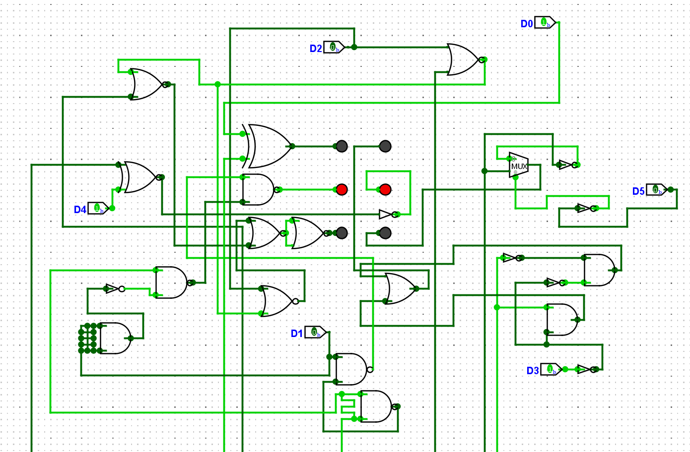

+++
date = '2026-05-10T13:09:07+10:00'
draft = false
# slug = "" # Set url-slug if title is problematic
title = 'Blind Cipher'
author = "Rabjho"
tags = ["crypto", "rev", "author"]
ctf = "DDC2026"
image = "circuit.png"
+++

This challenge is inspired by the style from early years of DDC, before AI and LLMs and while I still played in the junior category. Back then more challenges could be solved by-hand with pen and paper or knowledge of weird ciphers etc.

## Blind Cipher

> Min blinde ven vil gerne kunne kommunikere hemmeligt til formålet har han lavet det her kredsløb, men jeg forstår ikke hvordan det virker. Kan du hjælpe mig med at forstå hans besked?
> Når du har dekrypteret krypteringsteksten, skal du huske flagformateringen. For eksempel: ddc example flag -> ddc{example_flag}

> Author: Rabjho (me)
>
> Category: crypto

The challenge hand-out contains `cipher.txt`, the main contents of which is a set of 2 by 3 dots that are either filled in or not:

```
BLIND CIPHER
============================================================

| ○ ○ | ○ ○ | ○ ○ | ● ● | ○ ● | ○ ● | ○ ● | ● ○ | ○ ● | ○ ● | ○ ● | ● ● | ● ○ | ○ ● | ○ ● | ● ○ | ● ● | ○ ● | ● ○ | ● ○ | ○ ● | ○ ○ | ○ ● | ● ● |
| ● ● | ● ● | ● ○ | ● ○ | ○ ○ | ○ ● | ● ○ | ○ ○ | ○ ○ | ○ ○ | ● ● | ● ○ | ○ ○ | ● ○ | ○ ○ | ○ ○ | ● ○ | ● ○ | ○ ● | ○ ● | ● ○ | ● ○ | ● ○ | ● ○ |
| ○ ○ | ○ ○ | ○ ○ | ○ ○ | ○ ○ | ● ○ | ○ ○ | ○ ○ | ● ○ | ● ○ | ○ ○ | ○ ○ | ● ○ | ● ● | ○ ○ | ● ○ | ○ ○ | ○ ○ | ● ○ | ● ○ | ○ ○ | ○ ○ | ● ○ | ○ ○ |

```

Additionally the handout has an image of a digital logic circuit. The circuit is generally a mess: Inputs come from a bunch of different directions, many wires cross eachother, and wires are routed weirdly:



### Initial observations

In the middle of the logic circuit we can see 6 dots (LEDs) arranged in the same 2-by-3 grid as the ciphertext (CT). The first meaningful observation is that the lit LEDs match the first block of the ciphertext. Secondly, starting from D0, we can see it is a simple XOR operation with some input from outside the image. At this point one might, correctly, assume that the rest of the digits are also XOR-operations, implemented with other gates. In other words, some One-Time-Pad (OTP) is being applied.

If you don't care about how the XORs are implemented, jump to [Recovering the flag](#recovering-the-flag).

### XOR variants

**Bit 0 - Plain XOR.** Straight D XOR K, the reference.

**Bit 1 - NAND only (4 gates).** The classic XOR-from-NAND construction. NAND the two inputs together, then NAND each original input with that result, then NAND those two outputs together. Four gates, all NAND, and you've got XOR.

**Bit 2 - NOR only (5 gates).** Rebuilds XOR as "A OR B, but NOT both" entirely out of NOR gates. NOR with both inputs tied together acts as a NOT, so you invert D and K first, then chain three more NORs to get the OR-and-not-AND logic.

**Bit 3 - AND, OR, NOT.** The textbook definition - take A and NOT B, take NOT A and B, OR them together.

**Bit 4 - MUX-based.** This one's cute. K is the select line of a 2-to-1 MUX. When K is 0, D passes straight through. When K is 1, NOT D passes through instead. That's literally what XOR does - "give me D if K is off, flip D if K is on".

**Bit 5 - XNOR + NOT.** Sneaky - looks different but XNOR is just inverted XOR, so slapping a NOT on the output recovers XOR. A bit of a freebie if you know your gates.

### Recovering the flag

Looking at the ciphertext for a moment, we can observe that the first to blocks of 6-dots are identical. Given the flag format `DDC{}`, we can assume that what we're seeing is the letter-bigram "DD". We can thus induce that we're observing the same operation applied to each character of the flag/plaintext (PT) to get the ciphertext.

Next up, the challenge is themed around a blind-person. Knowing a bit about accessibility helps making the connection to Braille-writing, whose main form is 6-dots arranged in a 2-by-3 grid, like the one we see.

Since we know the operations must similar for each character the OTP is just 6-bits (one for each Braille dot) and it is reused for each character. At this point solving the challenge can be done using XOR's involution property.

We find the correct 6-bit OTP by XOR'ing the first character of CT and PT together, after finding the Braille-ASCII dots for `D`. Remember that Braille dot indices are read by column

```
1 4
2 5
3 6
```

$$
\begin{aligned}
\text{CT}_0 &= 0\;1\;0\;0\;1\;0 \\
\text{PT}_0 &= 1\;0\;0\;1\;1\;0 \\
\hline
\text{OTP} = \text{CT}_i \oplus \text{FLAG}_i \\
\text{CT}_0 \oplus \text{FLAG}_0 &= 1\;1\;0\;1\;0\;0
\end{aligned}
$$

where $i$ is the index of each character in the CT/PT.

With the OTP acquired it is just a matter of doing $\text{FLAG}_i = \text{CT}_i \oplus \text{OTP}$ for all $i$-characters of the Braille CT and converting the Braille PT to ASCII, [see wikipedia for a conversion table](https://en.wikipedia.org/wiki/Braille_ASCII).
